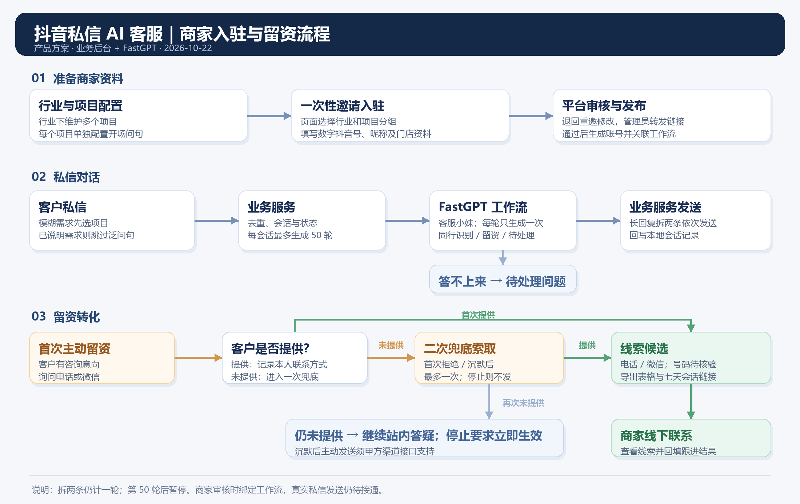

# 抖音私信 AI 客服 PRD

版本：v0.9｜2026-10-22｜实施中

## 目标

商家私信由业务服务接收、保存并交给 FastGPT 工作流按已审核商家资料答疑、识别同行和提取线索。未留资且不是同行时，模型先回答客户问题，再结合本轮内容生成留资邀请；明确拒绝或要求停止联系后仍继续答疑和邀请。仅按可做项目拼接的项目选择问句不索要；客户明确答应稍后提供联系方式或实际留资后，不再索要。

## 1. 行业与入驻

平台维护**行业 → 项目 → 项目开场问句**，草稿与发布版分离；行业不配置问句。例：装修装饰下的“老房翻新” → “您想做局部改造还是整屋翻新？”项目可分别保存、发布，商家只能选择本行业已发布项目。

平台发有有效期、令牌校验且只能提交一次的邀请链接；有效期可选 6、12、24 小时，默认 6 小时。商家直接在页面选择行业，再把该行业项目分别归入“主做／其他可做／不做”，各组可多选，同一项目只能处于一组，至少选一项主做。随后填写纯数字门店抖音号、抖音昵称、完整店名、服务区域、营业时间、门店详细地址（选填）、联系电话及是否可公开、话术类别单选项（到店/上门服务型、工厂批发型或零售型）、入驻联系人；页面预览后提交审核。服务型直接询问预计到店或上门时间；批发型询问购买数量；零售型先答疑并介绍下单附赠品的限量购买链接，本轮不索要。客户下一轮回复时，零售型先回应当前问题，再请其留个联系方式，由工作人员私发链接供其考虑。服务型、批发型则分别以计划到店或上门的时间如何确认（洗车等即办服务只说忙不忙或是否要等位）、折扣需门店或工作人员沟通为由邀请留资，并先回答客户当前问题。提交时服务端重新校验令牌、项目归属与分组。审核通过前，新版本不替换已发布资料。不收集项目价格或方案表。审核员必须从有权读取且已发布的 FastGPT 工作流中选择一项，服务端再次核验工作流及平台调用密钥后，才可审核通过；首次通过时，以门店抖音号生成账号，并在同一事务中关联商家与所选工作流。抖音昵称只用于展示。后续版本若更换抖音号，须先处理账号迁移，不能静默修改已有账号 ID。

已撤销的邀请可删除记录；行业及项目可删除，但被商家版本或有效接入账号使用时应拒绝。账号接入可移除，停止接收该账号的新消息，保留历史会话和发送记录；有待处理或待核对消息时先处理再移除。

“商家资料审核”列表提供“删除商家”，点击后须二次确认。确认后在同一事务中删除该商家的全部资料版本、已关联邀请、账号与工作流接入绑定、本地历史会话、消息与模型决策、线索及分享链接、待处理问题、发送与异常记录；其他商家及共用的 FastGPT 工作流应用保留。若该商家仍有正在处理或发送的消息，先拒绝删除并提示稍后重试。

审核退回必须填写原因。系统保存退回原因并生成 6 小时有效的新修改链接；管理员复制原因和链接，自行发给商家，不自动发送短信或微信。商家打开新链接后看到退回原因和上次填写的资料，可修改、预览并再次提交为新版本；原邀请链接仍不可重复使用。链接过期后管理员可重新生成。向外部商家发送时需使用商家可访问的业务后台地址，不能发送本机 `localhost` 链接。

门店资料只作为可确认事实。机器人不讨论具体价格、报价区间或方案细节；客户追问时说明需由门店根据实际需求确认，并说明留下联系方式后由哪家门店、为何联系。不得虚构资料、报价、服务或联系结果。

## 2. 对话与留资

业务服务保存原始消息和会话；每轮给 FastGPT 发送**本轮一条客户消息**、当前已审核商家资料及其项目分组／项目问句，使用同一活动会话的非空 `chatId` 保持历史。暂停后恢复使用新 `chatId` 代际；超时或发送取消时先核对状态，不盲目重试旧代际。平台统一配置工作流调用密钥，商家无需配置；审核时绑定已发布工作流。真实渠道授权仍待验收。

答疑使用简短口语化话术。FastGPT 每轮生成答疑；允许邀请且上一轮未索要过联系方式时，可生成与当前问题相关的留资邀请，业务服务决定是否附在末尾；每轮合成一条不超过 80 字的回复，超出时优先保留答疑结论和模型生成的留资邀请。每个会话最多自动生成 50 轮回复。第 50 轮回复发送后自动暂停；后续客户消息保留待处理，不再调用模型，后台显示已达上限且不可恢复机器人。

留资时人员称呼随商家行业变化：教培可称“老师”；家政维修岗位可称“师傅”，保洁或照护岗位明确时可称“阿姨”；岗位不明确或其他行业统一称“店里工作人员”。

FastGPT 只根据客户私信正文识别同行，并依据当前商家的已审核资料和项目分组答疑：main、available 可做，excluded 或未配置的项目不能当作本店业务。对“能不能”类问题先给明确结论，再说必要条件和本店可提供的帮助；通用知识可直接回答，允许不带数字的积极销售表述，不能编造具体通过率或保过。尚未留资、未明确答应稍后提供、上一轮未索要过联系方式且不是同行时，模型可生成与答疑相连的“留个联系方式”邀请，由业务服务判断是否发送；仅询问客户想了解哪个已配置项目时不邀请。明确拒绝或要求停止联系后仍继续答疑和邀请。首次收到本人联系方式时固定确认一次，后续继续答疑但不再索要。每个会话仍保留 50 轮自动生成上限；商家暂停及接入限制仍按原规则执行。机器人发出的邀请不出现敏感的渠道名称。

成人学历提升的通用答疑依据：[2026 年山东省成人高考报名办法解读](https://jnjy.jining.gov.cn/art/2026/8/24/art_59666_2711123.html)确认专升本前置学历要求；[教育部学历继续教育改革意见](https://www.moe.gov.cn/srcsite/A07/moe_743/202208/t20220816_653132.html)明确自 2025 年秋季起新生学习形式不再使用“函授”“业余”名称。具体地区、年份、专业条件以当年官方招生简章为准。

客户本轮主动留下本人电话或微信时，按客户选择的联系渠道固定回复：微信为“好的，稍后加您沟通，留意通过下”，手机号为“好的，稍后工作人员会给您致电沟通”；不再索要其他信息。上一条机器人回复索要过联系方式且本轮客户消息去掉首尾空格后只包含英文字母和数字时，先将符合 `1[3-9]` 开头的 11 位纯数字识别为中国手机号，其余至少 6 位才按微信号留资；显式提供的微信号也须至少 6 位。客户发来的疑似微信号不足 6 位时回复“麻烦您确认下您发的联系方式是否有问题”，不保存线索。其他情况由模型判断客户希望使用的联系渠道：手机号默认归电话；客户说“不要打电话”或“加我微信”时，归微信。线索列表只显示“电话／微信”两类；客户后续更正联系偏好时，更新该会话已有线索类型。联系方式只从客户本人消息原文提取为**线索候选**，保留来源；候选不等于已验证、已发送给商家或已跟进。商家查看本商家线索并在线下联系后回填状态，这部分仍待开发。

运营后台按抖音号、抖音昵称或门店名称模糊搜索线索，并按是否已导出筛选；当前筛选结果支持多选、全选和单行导出。导出生成仅含“类型、联系字段、会话记录链接”三列的 XLSX，成功生成后记录导出时间。会话记录链接由随机令牌保护，有效期七天，仅展示创建链接时已有的客户消息和已发送回复；管理员可单独生成链接并复制。正式环境需把业务后台公开地址配置为商家可访问的地址，不能使用 `localhost` 链接。导出状态不等于号码有效或商家已完成跟进。

后台长列表按筛选条件在服务端统计并分页查询，每页 20 条，支持上一页、下一页和输入页码跳转；线索跨页勾选后仍可一起导出或删除。

工作流只根据客户私信内容识别主动推销自身商品或服务的商家，不受行业是否相同影响；昵称仅用于展示、不参与判断。明确为同行时仅回复“不用呢 谢谢”，不索取或保存线索；该会话后续消息沿用同行状态。不确定身份时继续按普通客户处理。

## 3. 验收与实施边界

| 关键场景 | 验收标准 |
| --- | --- |
| 行业与入驻 | 项目问句分草稿／发布；邀请页按行业多选且分组互斥；跨行业项目被拒；令牌过期或用过即失效；审核须选有权限且已发布的工作流，工作流或平台调用密钥不可用时保持待审核 |
| 对外回复 | 按已审核项目配置答疑；正文主动推销才进入同行固定回复；不做项目如实说明 |
| 留资节奏 | 模型按本轮答疑生成留资理由；仅项目选择问句不索要，明确答应稍后提供或实际留资后不再索要；拒绝或要求停止联系后仍答疑和邀请；保留 50 轮上限 |
| 纯字母数字留资 | 仅当上一条机器人回复索要过联系方式时，本轮纯英文字母数字消息先判中国手机号，其余至少 6 位才判微信号，并回复首次留资确认；未索要或不足 6 位时不据此留资 |
| 同行识别 | 私信正文明确推销自身商家业务时，只回复“不用呢 谢谢”；无新线索，后续仍沿用同行回复 |
| 线索导出 | 搜索与已导出筛选准确；多选／全选导出 XLSX 三列；逐行可生成会话链接；链接过期后不可查看历史 |
| 会话一致性 | 只发本轮消息；恢复换 `chatId`；重试、长会话及业务库/FastGPT 历史可核对 |
| 回复样式与上限 | 客服小妹语气；每轮只发送一条不超过 80 字的回复，先答疑再邀请；同会话第 50 次生成后暂停，第 51 条客户消息不再触发生成 |
| 真实私信 | 拿到甲方接口契约后再实现授权、回调、发送与回执，模拟发送不算上线验收 |

当前 FastGPT 工作流已有发布版本，仍需核验发布内容与项目场景；商家审核时完成应用绑定。留资状态、商家线索页与真实渠道仍需继续实施。
